# ivan_market: looking inside - where and when the models react

The report says WHAT each model reacts to. These pictures show WHERE (which stocks, which ties) and WHEN (which window). **Red** raises the model's prediction, **blue** lowers it, grey does nothing. Tickers are on the nodes; node colour is the sector group. They illustrate how the model responds to controlled counterfactual nudges - they are not claims about the market. **Important:** the beeswarm, boxplot and dependence pictures ask the question on many sliding windows and do NOT apply the validity gating of the main table (report.md), so they also contain experiments that table excludes, for example where a concept could not keep the number of ties. Draw conclusions from report.md; use these to see the spread.

## Model: trend_clustering

It predicts: how clustered the market is, extrapolated from its trend. On this market it says **0.2631**.

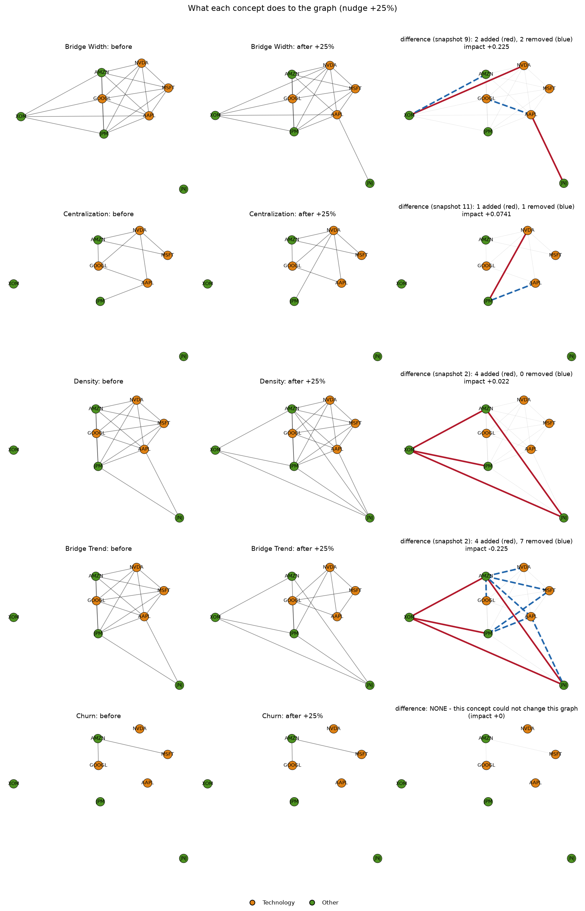

*For each concept, the graph before and after the nudge, and the difference: red lines are ties the concept ADDED, blue dashed lines are ties it REMOVED. Node colours are the groups. This shows exactly what 'a concept moved by x%' means for your graph.*

- Bridge Width: 2 tie(s) added, 2 removed in snapshot 9
- Centralization: 1 tie(s) added, 1 removed in snapshot 11
- Density: 4 tie(s) added, 0 removed in snapshot 2
- Bridge Trend: 4 tie(s) added, 7 removed in snapshot 2
- Churn: 0 tie(s) added, 0 removed in snapshot 12

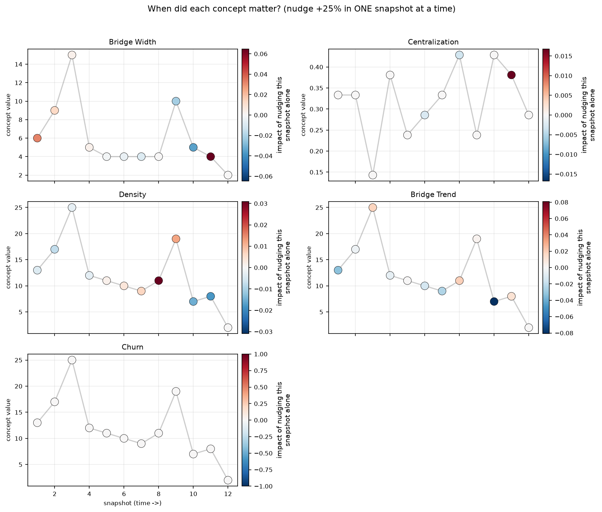

*Each dot is one snapshot; its height is the concept's value there and its colour is how far the prediction moves when ONLY that snapshot is nudged (red up, blue down). A model that only reads the latest snapshot is coloured only at the right-hand end.*

- Bridge Width: the prediction reacts when snapshot(s) 1, 2, 3, 4, 5, 6, 7, 9, 10, 11 are nudged
- Centralization: the prediction reacts when snapshot(s) 6, 8, 11 are nudged
- Density: the prediction reacts when snapshot(s) 1, 2, 3, 4, 5, 6, 7, 8, 9, 10, 11 are nudged
- Bridge Trend: the prediction reacts when snapshot(s) 1, 2, 3, 4, 5, 6, 7, 8, 9, 10, 11 are nudged
- Churn: nudging a single snapshot never moves the prediction

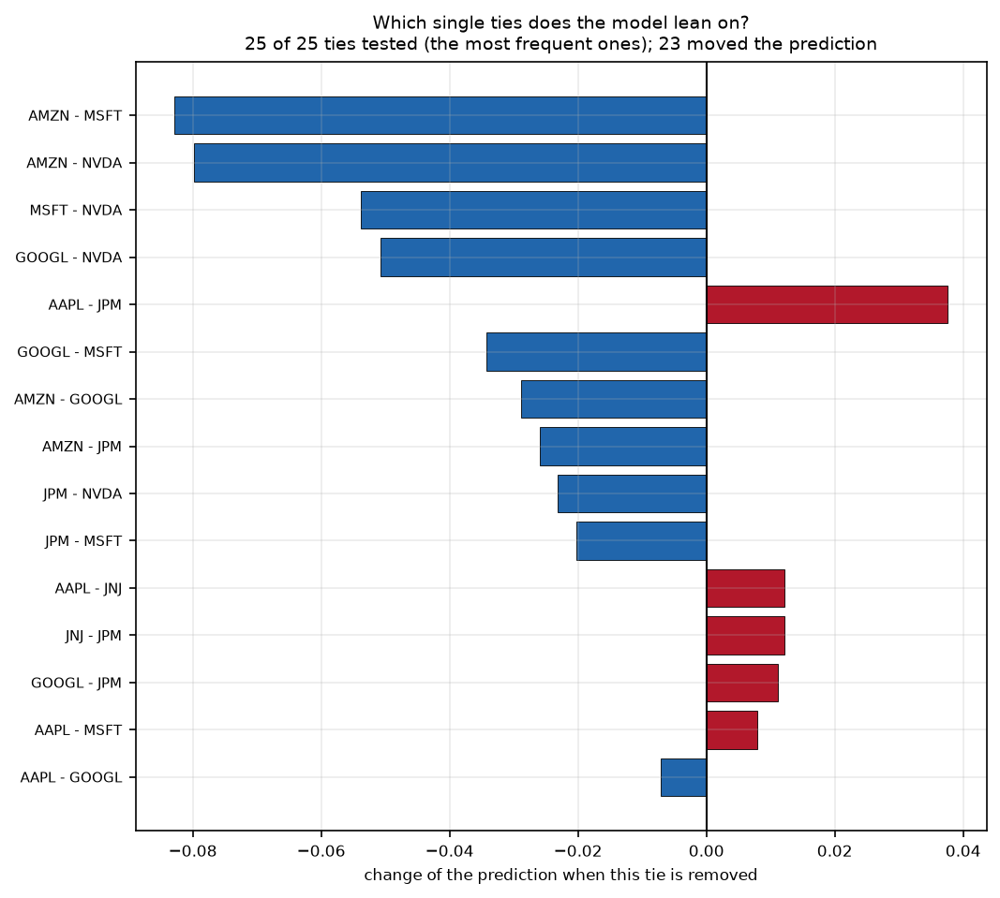

*One bar per tie: how much the prediction changes if that single tie is removed from every snapshot (red: prediction rises, blue: it falls). Ordered by size WITHIN this picture only. Ties that change nothing are not drawn - they are counted in the title.*

- 23 of 25 tested ties change the prediction when removed; the strongest is AMZN - MSFT (-0.0829)

*One dot per (tie, snapshot): the change of the prediction when that tie is removed from that one snapshot only. A model that reads only the latest snapshot is blind to the earlier ones - a flat picture is a result, not an error. Nothing is added up across time.*

- The model reacts to single-tie removals in snapshot(s): 1, 2, 3, 4, 5, 6, 7, 8, 9, 10, 11

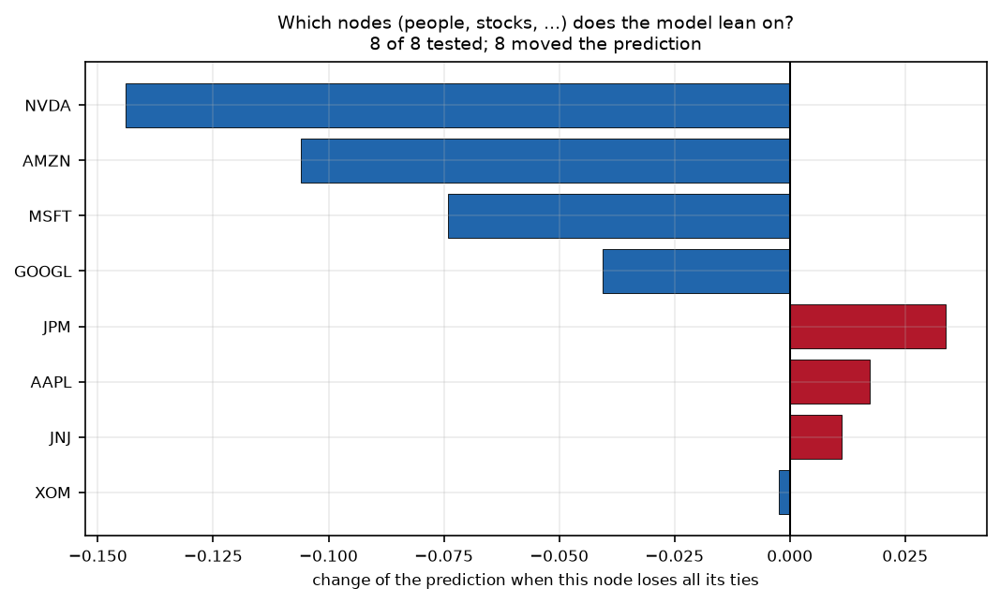

*One bar per node: the change of the prediction if that node loses ALL its ties (the node stays, so the graph does not shrink). Red: prediction rises, blue: it falls.*

- 8 of 8 tested nodes change the prediction when silenced; the strongest is NVDA (-0.144)

*The whole explanation in one picture: rows are concepts, columns are how hard each was nudged (left: less of it, right: more of it). Red raises the prediction, blue lowers it. n/a: the graph could not be changed that way. Blank: left out because that experiment failed a validity check (it is not shown rather than shown wrongly).*

*A good concept moves ITS property and leaves the others alone, so each concept's row should be strong in one column and near 0% elsewhere. Large entries elsewhere are side effects: the prediction may then be reacting to the side effect, not the concept. (Density is expected to move with every concept that adds or removes ties.)*

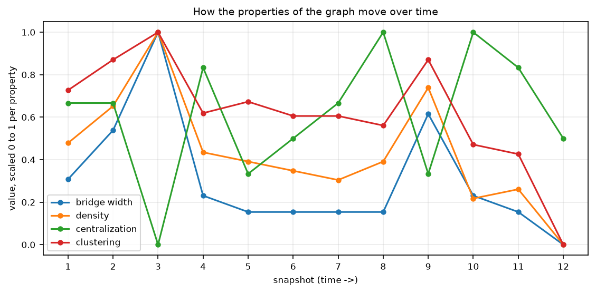

*Each property of the graph over time, rescaled so they can share one axis (only the shape is meaningful, not the height). A model that extrapolates a trend reads exactly these curves.*

*Green: the concept did what it promised. Red: it promised to keep the number of ties fixed but could not on this graph (usually too few free places to move ties). Grey: the graph could not be changed that way at all. Orange: another validity check failed (for example a trend that hit its floor). Experiments that are not green should not be used as evidence.*

- 10 of 30 experiments could not keep the number of ties the concept promised to keep - read those with care.

*Each concept has two triangles per nudge size: up-pointing for MORE of the concept, down-pointing for LESS. Red raises the prediction, blue lowers it. A sensible, symmetric response has the two on opposite sides of zero; the same side means the model reacts to any change, not to the direction.*

*The summary plot of TSAP, the time-series ancestor of TGAP: each bar is the base-10 logarithm of an impact, keeping its sign, so a tiny effect and a huge one both stay visible. Red raises the prediction, blue lowers it. Bar lengths are orders of magnitude, not amounts.*

*The global explanation: instead of one number per concept, every impact measured over many sliding windows of the history, both directions and several sizes of nudge. Red dots raise the prediction, blue dots lower it. A concept whose dots sit on both sides of zero has no steady effect. Windows overlap, so the dots are not independent samples. Rows use different units: compare directions and spread, never sizes between rows.*

- 7 windows of 6 snapshots each; 210 experiments, of which 188 changed the graph.
- Bridge Width: median impact -0.218; the prediction rises in 26% of the 42 experiments that changed the graph
- Centralization: median impact -0.175; the prediction rises in 21% of the 42 experiments that changed the graph
- Density: median impact -0.228; the prediction rises in 36% of the 42 experiments that changed the graph
- Bridge Trend: median impact +0.0134; the prediction rises in 55% of the 42 experiments that changed the graph
- Churn: median impact +0.024; the prediction rises in 55% of the 20 experiments that changed the graph

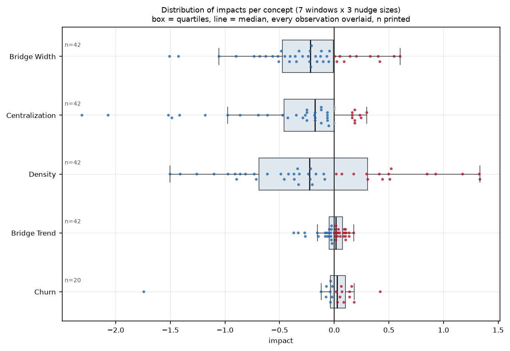

*The same observations as the beeswarm, summarised: the box covers the middle half of the impacts and the black line is the median; every single observation is drawn on top, so a box built from few points cannot pass for a distribution.*

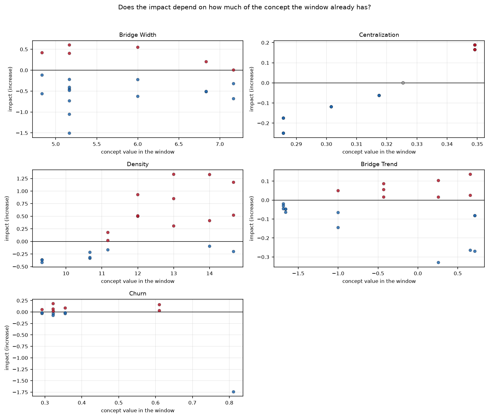

*Each dot is one window: how much of the concept it had (left to right) against the impact of nudging it up (height). A slope means the model reacts more when there is more, or less, of the concept to begin with; a flat cloud means a steady response.*

- Bridge Width: Spearman correlation -0.04 between the concept's value and its impact over 21 observations
- Centralization: Spearman correlation +0.95 between the concept's value and its impact over 21 observations
- Density: Spearman correlation +0.72 between the concept's value and its impact over 21 observations
- Bridge Trend: Spearman correlation -0.14 between the concept's value and its impact over 21 observations
- Churn: Spearman correlation -0.04 between the concept's value and its impact over 14 observations

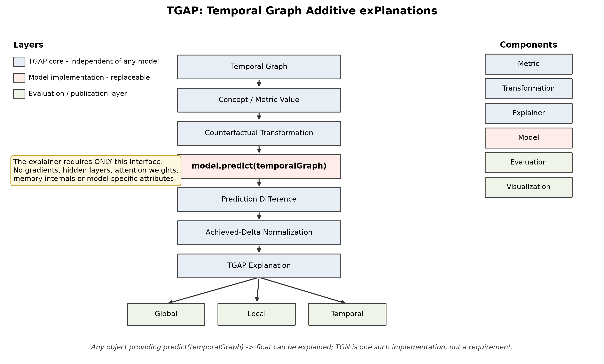

*The method in one diagram: take a model and a temporal graph, nudge one human-meaningful concept at a time, re-ask the model, and divide the change of the prediction by the change that was really achieved.*

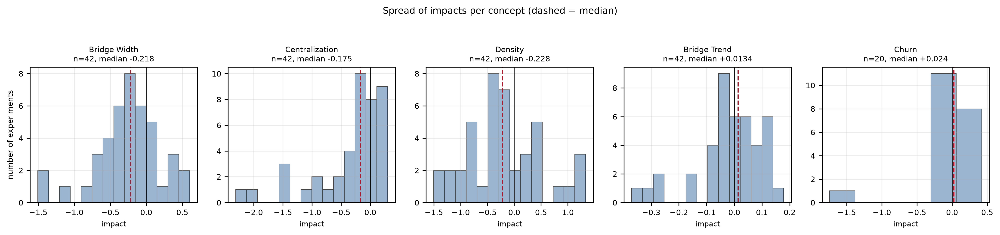

*How the impact of each concept is spread over all the windows and nudge sizes: a narrow bar away from zero is a steady effect, a wide or two-sided one is not. Each concept has its own horizontal scale.*

*An explanation is easier to use when only a few things carry it. Red is the share of experiments in which the prediction moved at all; exact zeros count as 'no response' because TGAP's concepts leave everything else untouched. High sparsity is not automatically good: a model that really depends on many things should give a dense answer.*

## Model: slope_bridge_width

It predicts: how fast cross-sector co-movement is growing or shrinking. On this market it says **-0.4685**.

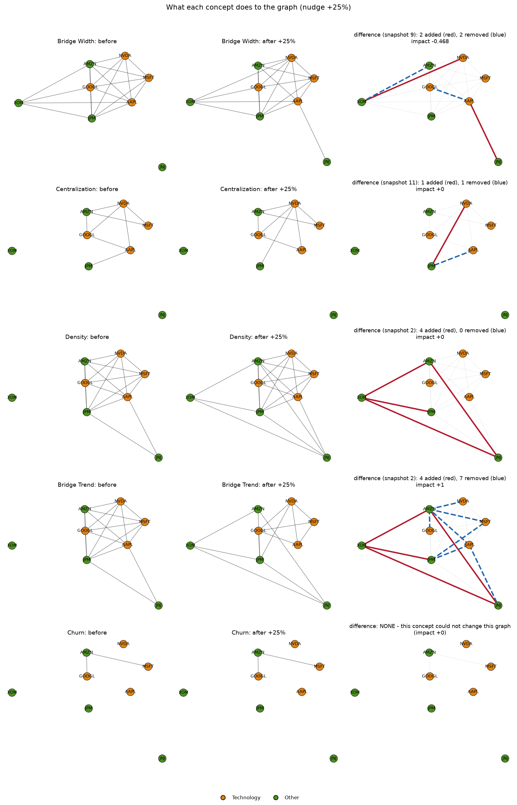

*For each concept, the graph before and after the nudge, and the difference: red lines are ties the concept ADDED, blue dashed lines are ties it REMOVED. Node colours are the groups. This shows exactly what 'a concept moved by x%' means for your graph.*

- Bridge Width: 2 tie(s) added, 2 removed in snapshot 9
- Centralization: 1 tie(s) added, 1 removed in snapshot 11
- Density: 4 tie(s) added, 0 removed in snapshot 2
- Bridge Trend: 4 tie(s) added, 7 removed in snapshot 2
- Churn: 0 tie(s) added, 0 removed in snapshot 12

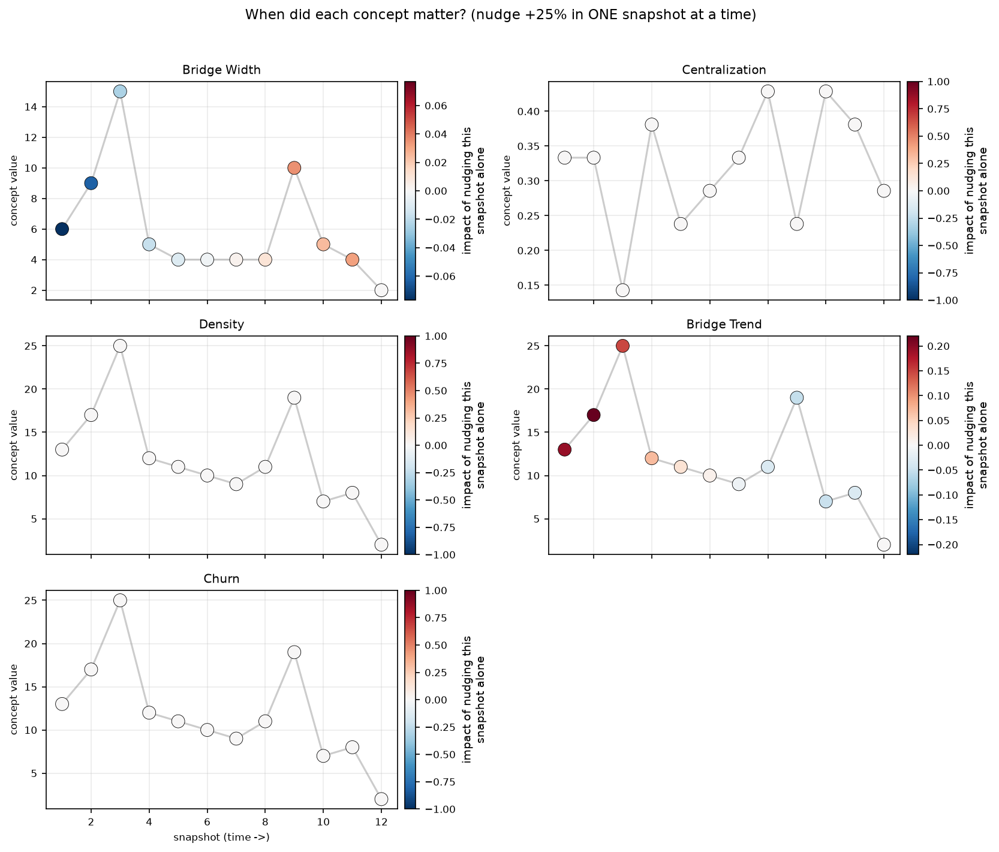

*Each dot is one snapshot; its height is the concept's value there and its colour is how far the prediction moves when ONLY that snapshot is nudged (red up, blue down). A model that only reads the latest snapshot is coloured only at the right-hand end.*

- Bridge Width: the prediction reacts when snapshot(s) 1, 2, 3, 4, 5, 6, 7, 8, 9, 10, 11 are nudged
- Centralization: nudging a single snapshot never moves the prediction
- Density: nudging a single snapshot never moves the prediction
- Bridge Trend: the prediction reacts when snapshot(s) 1, 2, 3, 4, 5, 6, 7, 8, 9, 10, 11 are nudged
- Churn: nudging a single snapshot never moves the prediction

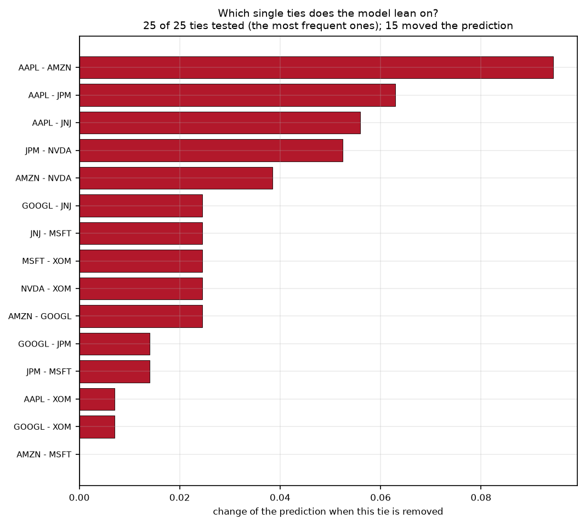

*One bar per tie: how much the prediction changes if that single tie is removed from every snapshot (red: prediction rises, blue: it falls). Ordered by size WITHIN this picture only. Ties that change nothing are not drawn - they are counted in the title.*

- 15 of 25 tested ties change the prediction when removed; the strongest is AAPL - AMZN (+0.0944)

*One dot per (tie, snapshot): the change of the prediction when that tie is removed from that one snapshot only. A model that reads only the latest snapshot is blind to the earlier ones - a flat picture is a result, not an error. Nothing is added up across time.*

- The model reacts to single-tie removals in snapshot(s): 1, 2, 3, 4, 5, 6, 7, 8, 9, 10, 11, 12

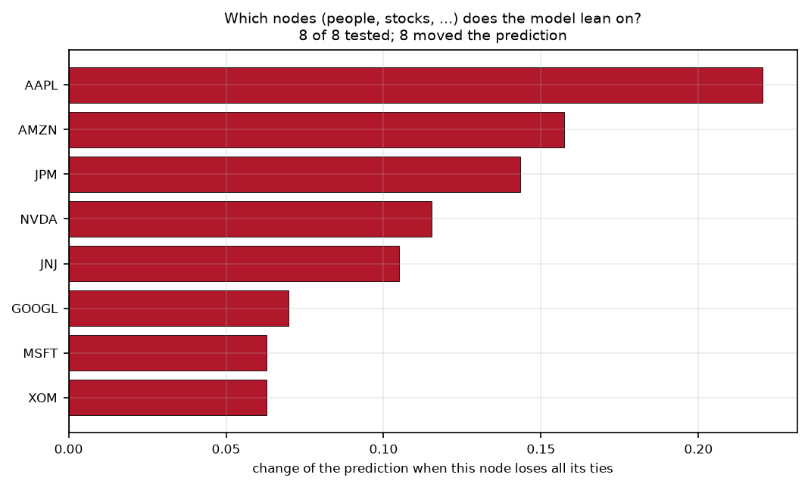

*One bar per node: the change of the prediction if that node loses ALL its ties (the node stays, so the graph does not shrink). Red: prediction rises, blue: it falls.*

- 8 of 8 tested nodes change the prediction when silenced; the strongest is AAPL (+0.22)

*The whole explanation in one picture: rows are concepts, columns are how hard each was nudged (left: less of it, right: more of it). Red raises the prediction, blue lowers it. n/a: the graph could not be changed that way. Blank: left out because that experiment failed a validity check (it is not shown rather than shown wrongly).*

*A good concept moves ITS property and leaves the others alone, so each concept's row should be strong in one column and near 0% elsewhere. Large entries elsewhere are side effects: the prediction may then be reacting to the side effect, not the concept. (Density is expected to move with every concept that adds or removes ties.)*

*Each property of the graph over time, rescaled so they can share one axis (only the shape is meaningful, not the height). A model that extrapolates a trend reads exactly these curves.*

*Green: the concept did what it promised. Red: it promised to keep the number of ties fixed but could not on this graph (usually too few free places to move ties). Grey: the graph could not be changed that way at all. Orange: another validity check failed (for example a trend that hit its floor). Experiments that are not green should not be used as evidence.*

- 10 of 30 experiments could not keep the number of ties the concept promised to keep - read those with care.

*Each concept has two triangles per nudge size: up-pointing for MORE of the concept, down-pointing for LESS. Red raises the prediction, blue lowers it. A sensible, symmetric response has the two on opposite sides of zero; the same side means the model reacts to any change, not to the direction.*

*The summary plot of TSAP, the time-series ancestor of TGAP: each bar is the base-10 logarithm of an impact, keeping its sign, so a tiny effect and a huge one both stay visible. Red raises the prediction, blue lowers it. Bar lengths are orders of magnitude, not amounts.*

*The global explanation: instead of one number per concept, every impact measured over many sliding windows of the history, both directions and several sizes of nudge. Red dots raise the prediction, blue dots lower it. A concept whose dots sit on both sides of zero has no steady effect. Windows overlap, so the dots are not independent samples. Rows use different units: compare directions and spread, never sizes between rows.*

- 7 windows of 6 snapshots each; 210 experiments, of which 180 changed the graph.
- Bridge Width: median impact -6.66e-16; the prediction rises in 48% of the 42 experiments that changed the graph
- Centralization: median impact +0; the prediction rises in 0% of the 34 experiments that changed the graph
- Density: median impact +0; the prediction rises in 0% of the 42 experiments that changed the graph
- Bridge Trend: median impact +0; the prediction rises in 50% of the 42 experiments that changed the graph
- Churn: median impact +0; the prediction rises in 0% of the 20 experiments that changed the graph

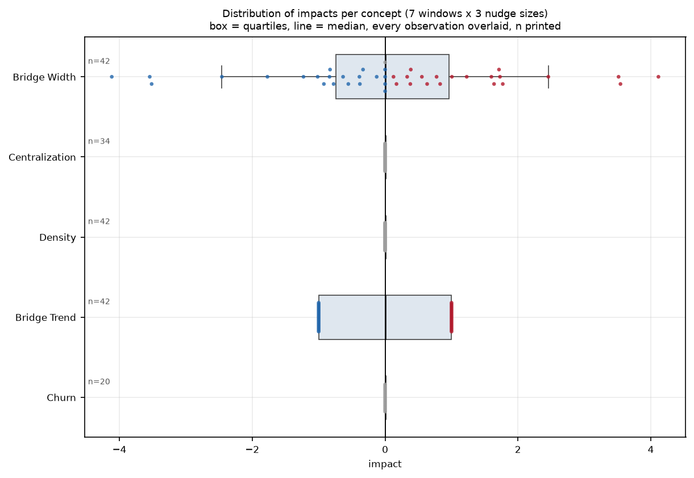

*The same observations as the beeswarm, summarised: the box covers the middle half of the impacts and the black line is the median; every single observation is drawn on top, so a box built from few points cannot pass for a distribution.*

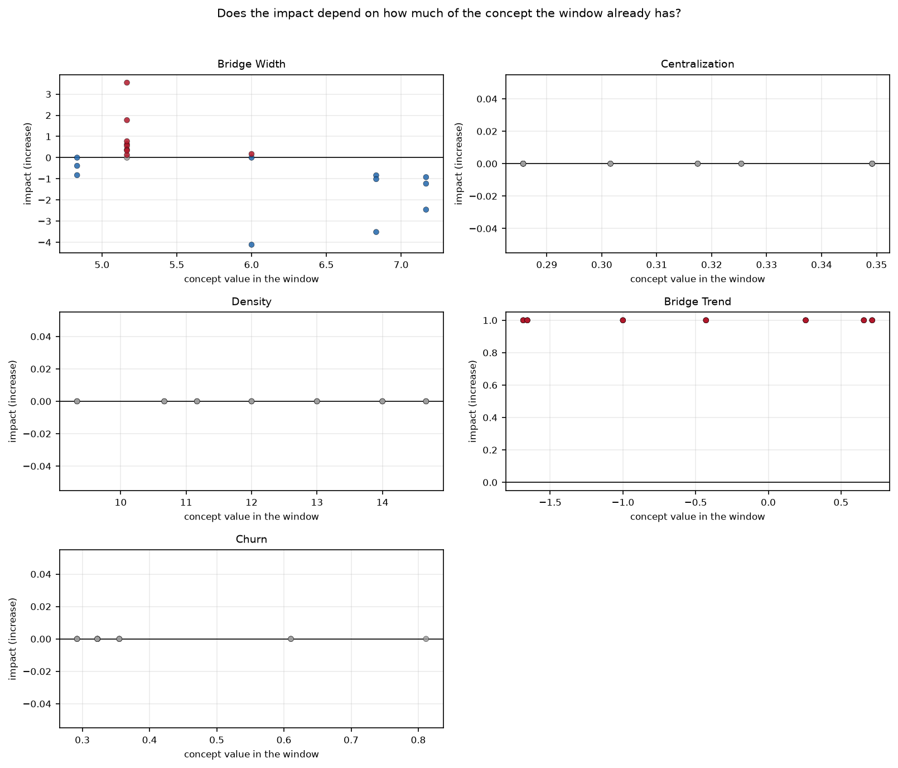

*Each dot is one window: how much of the concept it had (left to right) against the impact of nudging it up (height). A slope means the model reacts more when there is more, or less, of the concept to begin with; a flat cloud means a steady response.*

- Bridge Width: Spearman correlation -0.57 between the concept's value and its impact over 21 observations

*The method in one diagram: take a model and a temporal graph, nudge one human-meaningful concept at a time, re-ask the model, and divide the change of the prediction by the change that was really achieved.*

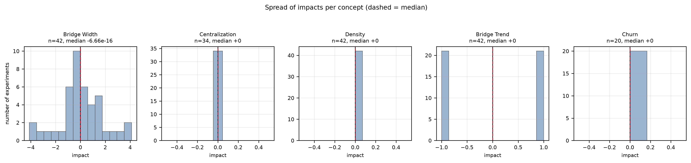

*How the impact of each concept is spread over all the windows and nudge sizes: a narrow bar away from zero is a steady effect, a wide or two-sided one is not. Each concept has its own horizontal scale.*

*An explanation is easier to use when only a few things carry it. Red is the share of experiments in which the prediction moved at all; exact zeros count as 'no response' because TGAP's concepts leave everything else untouched. High sparsity is not automatically good: a model that really depends on many things should give a dense answer.*

## The windows

Snapshot numbers in the pictures are the correlation windows, oldest first: 1 = 2022-03-21, 2 = 2022-08-16, 3 = 2023-01-12, 4 = 2023-06-09, 5 = 2023-11-06, 6 = 2024-04-04, 7 = 2024-08-30, 8 = 2025-01-29, 9 = 2025-06-27, 10 = 2025-11-20, 11 = 2026-04-22, 12 = 2026-09-18.
